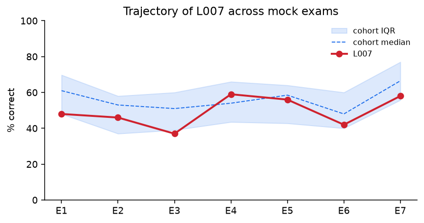
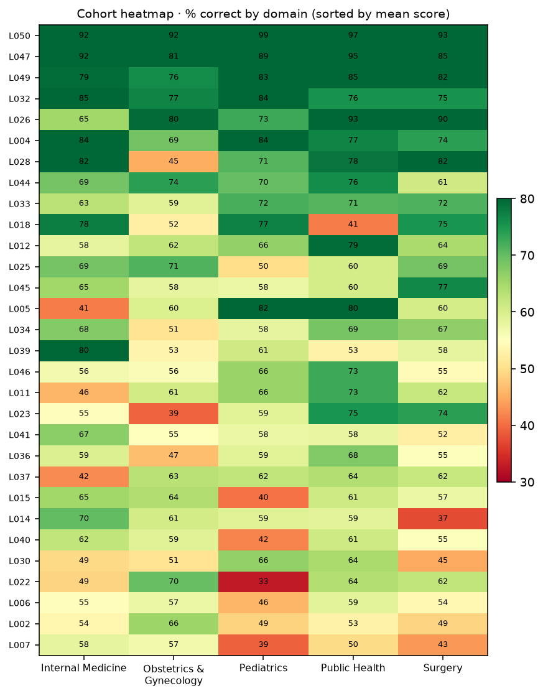
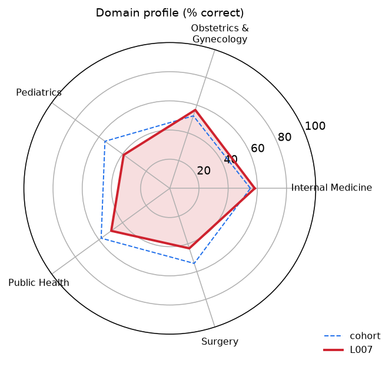

# Student Performance Reports


> Turn a series of mock exams into **one actionable report per learner** and a
> **cohort overview** for faculty — in a single command.

Mock-exam programs generate a lot of data but little guidance. Learners want to
know *"Am I improving? Where should I study next?"*; coordinators want to know
*"Who needs support, and in which areas?"* This project consolidates every
response from every exam and answers both questions with formatted Excel
workbooks and ready-to-share figures.

<p align="center">
  
</p>

## ✨ What each report contains

**Learner workbook** (`report_<id>.xlsx`)

| Sheet | Content |
|---|---|
| Summary | Exams taken, mean and last score, trend relative to the cohort, top-priority topic |
| Trajectory | Score in each mock exam next to the cohort mean, with a line chart |
| Domains | % correct per domain vs cohort, gap colour-scaled, bar chart |
| Competencies | Diagnosis, management, prevention, clinical reasoning — with data bars |
| Priorities | Topics ranked by a transparent priority score (see below) |

**Cohort workbook** (`cohort_overview.xlsx`) — one row per learner with mean,
last score, trend, domain heatmap and an *attention* flag; summary statistics per exam.

<p align="center">
  
  
</p>

## 🚀 Quick start

```bash
git clone https://github.com/alencarpeixotofilho-cloud/student-performance-reports.git
cd student-performance-reports
pip install -e .

python examples/generate_sample_data.py          # 50 learners x 7 exams x 100 items
python -m perfreport --input examples/data --output out/
```

```text
out/
├── cohort_overview.xlsx
├── cohort_heatmap.png
└── learners/
    ├── report_L001.xlsx
    ├── trajectory_L001.png
    └── ...
```

A sample learner workbook is included at [`docs/sample_report_L007.xlsx`](docs/sample_report_L007.xlsx).

### Input format

| File | Columns |
|---|---|
| `exams.csv` | `exam_id`, `date`, `label` |
| `items.csv` | `exam_id`, `item_id`, `domain`, `topic`, `competency` |
| `responses.csv` | `learner_id`, `exam_id`, `item_id`, `correct` (0/1) |

The long format makes it easy to plug in any exam platform export.

## 🧮 Methods

* **Relative trend.** Raw percentages are not comparable across exams of
  different difficulty, so each score is standardized within its exam (*z*).
  The slope of *z* over exam order classifies the learner as *improving*,
  *stable* or *declining* relative to the cohort.
* **Gap to cohort.** For every domain, topic and competency:
  `gap = learner % − cohort %`.
* **Priority score** for weak areas:

  ```text
  priority = (max(0, target − score) + max(0, −gap)) × (1 + 10 × topic_weight)
  ```

  It rewards topics that are below the target (default 60%), below the
  cohort, and that weigh more in the exams. Topics with too few items
  (default < 8) are excluded to avoid noise.
* **Attention flag.** Last score below 50% or a declining trend.

## 🗂️ Repository structure

```text
student-performance-reports/
├── perfreport/
│   ├── metrics.py     # scores, trends, gaps, weak areas, cohort overview
│   ├── excel.py       # formatted workbooks with charts & conditional formatting
│   ├── figures.py     # trajectory, heatmap and radar figures
│   └── cli.py         # batch build
├── examples/          # synthetic cohort generator (+ generated data)
├── docs/              # figures and a sample workbook
└── tests/
```

## 🔒 Data & privacy

This repository contains **no real data** about students, faculty or institutions.
The cohort in [`examples/`](examples/generate_sample_data.py) is simulated from a
logistic model with learner ability, domain profile and growth rate; learner ids
(`L001`, …) are fictitious. When used with real data, keep input files out of
version control — the `.gitignore` already excludes spreadsheets and data folders.

## 🛣️ Roadmap

- [x] Consolidation and learner metrics
- [x] Learner and cohort workbooks
- [x] Trajectory, heatmap and radar figures
- [ ] PDF version of the learner report
- [ ] Early-warning model (logistic regression on trajectory features)
- [ ] Mapping to an external competency framework file

## 📄 License

Released under the MIT License. See [`LICENSE`](LICENSE).
